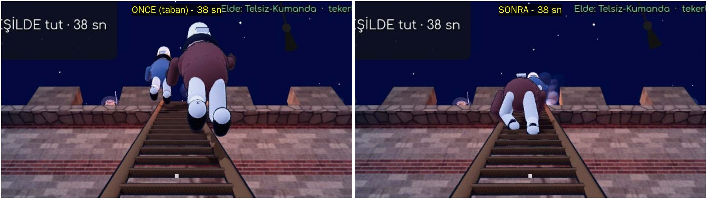

# Tırmanma animasyonu — rapor (dal `wip/tirmanma`, taban `wip/duzeltme-p3` `8cfc996a`)

## 1. 38o ÖNCE | SONRA (sahibinin karesi: aynı kamera, aynı an)

`p01_38o_once_sonra_oyuncu_kamerasi.jpg` — oyuncunun gerçek kamerası (merdivenin ayağında çömelmiş, bot bakışı), tutma
sayacı **38 sn** iki karede de (tutma başlangıcından +6,6 sn; ikisi de sonda koşusunun oyuncu kamerası karesi, kamera oynatılmadı); ekranlı koşu, `PACE=1`, 1280×720, kırpılıp 2× büyütüldü. ÖNCE = taban kodu (depo dışında
`git show` kopyası), SONRA = bu dal.

- ÖNCE: iki tayfa merdivenin ucundan yukarıda, gökyüzünde; bacakları merdivenin dışında, hiçbir şeye değmiyor
  ("boşluğa tırmanıyo gibiler").
- SONRA: tayfa merdivenin **üstünde**: gövde yatık merdivene yaslı, dizler/ayaklar basamaklarda, dikmeler iki yanında ve
  basamaklar altında seçiliyor. Üstteki (mavi) tayfa 2,9 m yukarıda, alttakinin sağ omzunun ardında kısmen görünür.

Ek paftalar (38o):
- `p02_38o_sonda_yan_12kare.jpg` — **sonda** (yandan kamera, ekranlı oynanış koşusunda tutma evresine eklenen geçici
  kamera; `tests/_tmp`, depoya girmez): alttaki tayfa iki adım (bir tam çapraz döngü) çıkıyor; sağ el bir basamağı
  bırakıp üsttekine uzanıyor, sol diz kalkıp ayak iki basamak üste basıyor, sonra öbür çift. Eller basamakta, ayaklar
  basamakta (ayakların bir kısmı HUD'un denge çubuğunun ardında).
- `p03_38o_sonda_oyuncu_kamerasi_8kare.jpg` — aynı koşuda oyuncu kamerasıyla 8 kare (0,6 sn arayla). İlk 5 karede tutma
  başlığı (bölümün kendi bandı) tayfaların önünde; 6–8. karelerde tayfa merdivenin üstünde.
- `p04_oyuncu_tirmanisi_once_sonra_38o.jpg`, `p05_oyuncu_tirmanisi_birinci_sahis_6kare.jpg` — oyuncunun kendi tırmanışı
  (madde D).

### 38o'da tayfaların akışı (B) — seçim ve gerekçe
Tutma süresi boyunca: üstteki (7,0 m'den) tepenin iki basamak altına çıkıp orada tutunur (çatal o tepeyi iter), son
çeyrekte en üst basamaklara çıkar; alttaki (3,5 m'den) 1–2 basamaklık hamlelerle (3,4–5,0 sn arayla) yavaş yavaş yükselir,
üsttekinin 2,9 m altında kalır. İbre kenara kaçınca (|denge| > 0,45), çatal penceresinde ve ateş sırasında (oyuncu
merdiveni bırakmışken) ikisi de adımını bitirip **sıkı tutunur** (gövde merdivene 3 cm daha yaklaşır, baş eğilir);
sakinleşince 1,2 sn sonra yeniden çıkar. Merdiven `rotation.z` ile sallanınca gövde, eller ve ayaklar merdivenle
birlikte döner (merdiven her karede yeniden okunur). Kayışta (`|denge| ≥ 1`) bırakır, var olan düşüş tween'iyle güverteye
iner, 1,2 sn sonra merdivene 2,3/3,4 m'den yeniden tutunur (0,7 sn'lik geçişle; ışınlanmaz).
Tutma bitince (`_crew_over`): sonra oyuncu aynı merdivenden tırmanıyor (`_climb`), yolu kapatılmamalı ve tayfa birden
yok olmamalı. Bu yüzden önce üstteki, sonra alttaki tepeye çıkıp **mazgala geçer** (1,7 sn: eller merdivenin ucunda, sağ
bacak atılır, gövde dikleşerek içeri çekilir), sur yolunda 2,6 m yana yürür ve siperin ardında sahneden alınır. Oyuncu
merdivenin dibine konduğunda (bir replik sonra) ikisi de merdivenden çıkmış oluyor. Eskiden tutma bitince ikisi de
merdivenin ortasında `queue_free` ile birden kayboluyordu.
`HOLD_TIME`, `fork_at`, `pot_at`, `FORK_WINDOW`, sayaçlar, kazanma/kaybetme, tayfa sayısı, replikler değişmedi
(`git diff 8cfc996a -- scripts/chapter38o.gd`: yalnız yerleştirme satırları, `_crew_*` işlevleri, `CLIMB` sabiti).

## 2. Kendi karelerime bakınca hâlâ kötü olanlar

- **38o, üstteki tayfa:** oyuncu kamerasından alttakinin ardında büyük ölçüde kapalı (iki tayfa aynı merdivende, aynı
  bakış çizgisinde; ±0,12 m yana kaydırdım, daha fazlası eli dikmeden taşırıyor). "Gökyüzünde asılı" değil ama ikisi
  ayrı ayrı okunmuyor. KISMEN.
- **38o, uzaktan küçük:** merdiven bakış çizgisine neredeyse paralel; 3,5–8 m'deki tayfalar kadrajın ortasında küçük
  (p01 kırpılıp büyütüldü). Oyuncunun gördüğü boyutta el–basamak teması seçilmiyor; seçilen: dizler/ayaklar basamakta,
  dikmeler iki yanda.
- **38o, börk:** baş aşağı bakınca (ara sıra) uzun börk merdivene doğru devriliyor (p02, 7–8. kare); dikmeye değip
  değmediği karede kesin değil.
- **38o ilk 5 kare:** bölümün kendi tutma bandı tayfaları kapatıyor (değiştirmedim, bant metni ve süresi korunur).
- **Oyuncunun kendi tırmanışı (D):** eller basamaklarda ama çoğu karede yalnız biri kadrajda; öbürü `hold_both`'un
  ekran kutusu yüzünden kadrajın altında kalıyor (p05). KISMEN.
- **30o geç kalan azap (p08):** ÖNCE'de göğsüyle mazgal aralığında el sallıyordu (merdivenin ucundan 1,4 m yukarıda,
  ayakları boşlukta). SONRA'da kalça merdivenin ucunda (geçmez), ayaklar en üst basamakta, eller havada; ama yerleştiği
  yer merlonun ardına düşüyor: yalnız fes, başın üstü ve bir el görünüyor. Sahne "başını mazgaldan uzatır" anlatımı
  zayıfladı. KISMEN.
- **42b (p06):** üstten bakışta gönüllünün başı merdivenin tepesine yapışık; elleri miğferinin altında kalıyor, karede
  seçilmiyor. KANITSIZ (yandan kare yok).
- **Hücum askerleri (p07, sonda):** uzun etekli kaftan bacakları örtüyor; ayakların basamakta olduğu yandan da zor
  seçiliyor (denetim ölçüsü geçiyor).

## 3. Maddeler

### A. Ortak tırmanma animasyonu — DÜZELDİ (38o'da karede; öbür yerlerde ölçüyle, karede KISMEN)
`scripts/npc/climb_anim.gd` (yeni; `class_name` yok, `preload` ile). Kişinin çocuğu olarak eklenir, kişinin
`_process`'inden sonra çalışır, Rig'i `lock` ile durdurur:
- Kök merdivene paralel (`Basis(sağ, up_dir, −front_dir)`), göğüs merdiven düzlemine ~0,20 m (`hip_out` 0,47; kısa kollu
  askerde 0,42), gövde merdivene 2° eğik.
- Eller `Rig.reach` (oyunun var olan kol IK'si) ile **gerçek basamaklara** (basamak ekseninin 4 cm önü, 2,5 cm üstü),
  ayaklar yeni iki kemikli bacak IK'si (`_leg_reach`) ile **gerçek basamaklara** (taban basamağın üstünde, bilek merdivene
  paralel). Basamak yerleri `Ladder.RUNG/WIDTH` ya da `set_line(dip, tepe, ön, ilk basamak, aralık, genişlik, çerçeve)`.
- Çapraz döngü: çift adımda sağ el + sol ayak, tek adımda sol el + sağ ayak; kalkan uzuv iki basamak üste geçer, gövde
  bir basamak (0,36 m) yükselir; el merdivenden 12 cm açılarak yay çizer (bırakır → kalkar → uzanır → tutar), ayak elden
  sonra kalkar. Kalça adım yönünde 3,5 cm salınır, baş yukarı bakar, 4–8 sn'de bir aşağı bakar.
- Durumlar: tırman/in (`go_to`, `goal`, `speed`), bekle (tam adımda durur), sıkı tutun (`brace`), tepeden mazgala geç
  (`mantle`), tepeden bakış (`peek`), kayarak iniş (`sliding`), bırak (`release`: gövde dikleşir, düşüşü çağıran yürütür).
  Sahnenin kendi zamanlaması varsa `follow(m)` / `follow_frac(k)` (süre/sonuç değişmez, gövde basamaklara oturur).
- Sallanma: merdiven her karede okunur; `rotation.z/x` ile kişi merdivenle birlikte döner, eller basamaktan kopmaz
  (sondada 4 tur ±0,06 rad sallantı: `CLIMBAUDIT` 0).
- Silah: tırmananlarda (38o tayfa, hücum askeri, 30 askeri) elde silah yok; düellocu (`duelist.gd`) tırmanırken kılıcı
  elde: kılıcın gövdeye girip girmediğine BAKILMADI.
- Ucuz sürüm (`full = false`): kök, gövde, baş her kare; uzuv IK'si ve denetim üç karede bir. Hücumda kameradan 30 m+,
  Blakherna arka planında 25 m+ uzaktakiler.

### B. 38o — DÜZELDİ (p01, p02, p03)
Yukarıdaki akış. Kalan kusurlar 2. başlıkta.

### C. Oyun geneli — KISMEN
Bütün merdiven tırmanışları bağlandı (tablo aşağıda), denetim bütün bölümlerde 0 satır; ama bölüm bölüm oynanış karesi
yalnız 38o'da var. 30'da bot merdivenleri kadraj dışında itiyor (ekranlı oynanış koşusunda tırmanan kareye girmedi:
KANITSIZ); 30o ve 42b için bölümün kendi `--shots` kameralarıyla ÖNCE | SONRA (p08, p06); hücum (assault) için yalnız
sonda (p07). 29o ip: el üstüne el (oyuncu; ipte NPC tırmanan yok) — kare alınmadı, KANITSIZ.

### D. Oyuncunun kendi tırmanışı — KISMEN (p04, p05)
ÖNCE: merdivende sağ el havada, sol el yok (p04 alt/sol). SONRA: `player.gd` `_ladder_hands_tick`: iki el
merdivenin yerelinde basamaklara (`hold_both`, merdiven sallanınca onunla gider), çapraz döngü `_ladder_t`'den; her
basamak geçişinde var olan adım sesi (`Audio.step`). Bakış, hız, denetimler değişmedi. Kamera yukarı-aşağı salınımı
eklenmedi (var olan `_bob` artışı duruyor). Bir el çoğu karede kadrajın altında.

### E. Denetim `CLIMBAUDIT` — DÜZELDİ
`climb_anim.gd` `_audit`: her tırmanan için (ucuz sürümde üç karede bir) el–en yakın basamak/dikme ≤ 0,06 (tutarken),
ayak tabanı–basamak ≤ 0,06 (basarken), gövde ekseni–merdiven ekseni ≤ 8°, göğüs–merdiven 0,15–0,35 m, kalça merdivenin
ucunun 5 cm'den fazla üstünde değil. Aşan ölçü `CLIMBAUDIT <bölüm> <kişi> <ölçü>=<değer>` basar (aynı kişi/ölçü için
saniyede bir satır). Susturma işareti yok. Test paketinde `climbaudit=` sütunu olarak sayıldı: **0** (aşağıda).

## 4. Bağlanan yerler

| Yer | Ne değişti |
|---|---|
| `scripts/chapter38o.gd:721` | iki tayfa `CLIMB.attach` (eskiden `point_at + front×0,4` dimdik); `_crew_tick` 558, `_crew_remount` 586, `_crew_over` 602 / `_crew_mantle` 616; kayışta `release` 770 |
| `scripts/chapter30.gd:185-189` | tırmanan asker `follow(height×k×0,92)` (CLIMB_TIME aynı); `_push` 344 ve `_board` 383'te `release`; `_run_shots` 608 |
| `scripts/chapter30o.gd:1298-1303` | `_on_ladder` → `follow` + `peek` (geç kalan azap); `_azap_slide` 1325 `sliding`, 1336 `release` |
| `scripts/chapter33o.gd:191-195` | kırılan merdivende işçi (`set_line`, merdiven 2'nin basamak hattı 0,4 m), 1,2 sn/3 m aynı; düşüşte `release` 213 |
| `scripts/chapter42b.gd:316-320` | gönüllü `_place_climber` → `follow(_climb_t − 0,15)`; itilince `release` (merdiven yatarken onunla yatar) |
| `scripts/combat/duelist.gd:1247-1258` | `climb_in` tırmanışı: en yakın `Ladder` (yoksa base–top hattı) `follow_frac`; atlayış/itilişte `release` |
| `scripts/level/assault.gd:569-590` | hücum merdivenleri (genel hat, 0,45 m aralık) `follow_frac(.., true)`, aynı merdivende görünüşte ≥ 0,8 m aralık; mantık yeri `lp` ile ayrı tutuldu (sıra/çarpışma kararları değişmedi) |
| `scripts/level/blachernae.gd:468-473` | arka plan tırmananları `follow(t − 0,93)`, 25 m+ ucuz sürüm; düşüşte `release` 444 |
| `scripts/player/player.gd:628` | oyuncunun merdiven elleri (`_ladder_hands_tick`, `_ladder_hands_off`) |
| `scripts/chapter29o.gd:366` | ipte el üstüne el (4 çekiş / 2,2 sn) |

## 5. Testler

- `parse_check`: **PASS** (249 betik).
- Başsız paket, son kodla (`8cfc996a` + bu dal, son kayıt): değişen ve bağlanan bütün bölümlerin `tests/run_tests.sh`'taki
  **bütün varyantları** — 38o (4), 30 (4), 30o (4), 33o (3), 42b (2), 29o (2) ve ortak dosyaları (assault, blachernae,
  duellocu, oyuncu merdiveni) kullanan 0, 20 (7), 20o (10), 21 (6), 22 (7), 22o (6), 25 (7), 26 (14), 26o (5), 28o (4),
  29 (2), 31o (4), 32o (7), 36b (2), 37o (3), 41o (2): **106 koşu, 106 `AUTOTEST PASS`**, `--max-fps 20`.
- **`CLIMBAUDIT`: 106 koşunun hepsinde 0 satır.** (Ara koşularda çıkan aşımlar — asker kol erişimi, 30o tepeden bakış,
  Blakherna 0,061 — düzeltildi; son paket bunlardan sonra baştan koşuldu.)
- Öbür yasak satırlar (son pakette 3 koşuda birer satır; üçü de tabanla karşılaştırıldı):
  - `30o =lose`: `ARMAUDIT unarmed foe_dist=2.1` (1 satır). Aynı varyant bu dalda 6 koşunun 2'sinde çıktı, taban
    kopyasında 3 koşunun 0'ında. Merdiven elleriyle (eşyanın cebe girip çıkışı) ilişkili olabilir; nedenini bulamadım.
    **AÇIK / KANITSIZ** (bu dalın getirdiği aralıklı bir hata olma olasılığı var).
  - `42b =lose`: `VISAUDIT overlap` iki `CityLife{carry}` yayası, kuşatma ovasında (-44, 0, -44): tırmanmayla ilgisiz;
    tabanda bu koşu temiz çıktı, aralıklı sayıyorum (KANITSIZ).
  - `20 =hit`: `VISAUDIT sunk` düellocu (sur yolunda, tırmanış dışı); tabanda aynı varyantta başka bir `VISAUDIT
    personhidden` çıktı: bölüm aralıklı.
- Hücum sahnesinde (assault) ara koşularda bu dalın getirdiği `VISAUDIT insolid` (genel hatta ilk karede kişinin dünya
  ortasına konup oradan merdivene geçmesi) ve `VISAUDIT overlap` (aynı merdivende tepede sıkışma; ucuz sürümde kökün
  mantık yerine sıçraması) bulundu ve düzeltildi; son pakette 20/26/26o'da bu satırlar yok.

### Performans (RINFO, ekranlı, `PACE=1 --hitchaudit`)
38o tutma evresi, tutma başlangıcından sonraki ilk üç örnek (ÖNCE taban | SONRA son kod):

| örnek | çizim | üçgen (prims) | proc |
|---|---|---|---|
| 1 | 2773 → 2693 | 2090k → 2083k | 1197 → 822 ms |
| 2 | 2743 → 2645 | 2080k → 2045k | 1123 → 783 ms |
| 3 | 2701 → 2599 | 2058k → 2019k | 955 → 646 ms |

Hücum (20, assault 24 tırmanan, oyun saatine hizalı t=5…15):

| t | çizim | üçgen | proc (kare süresi) |
|---|---|---|---|
| 5 | 5280 → 5275 | 7745k → 7757k (+0,2%) | 1309 → 1464 ms |
| 9 | 5397 → 5393 | 7924k → 7946k (+0,3%) | 1397 → 1516 ms |
| 13 | 6191 → 6123 | 8246k → 8181k | 1351 → 1828 ms |

Çizim artmadı, üçgen en çok +0,3% (yeni ağ yok; animasyon yalnız düğüm döndürür). Kare süresi bu makinede (yazılım
çizim, xvfb) çok gürültülü; hücumda SONRA 9–35% yüksek çıktı. Ölçülen kişi başı maliyet (`tests/_tmp` sondası, 2000
tekrar): tam sürüm poz 17–19 µs + denetim 7 µs; eski sabit poz (Rig) 10–11 µs. 24 hücum tırmananı tam sürümde ≈ 0,6
ms/kare; uzaktakiler ucuz sürümde (uzuv IK + denetim üç karede bir). Yani kare süresindeki farkın büyük kısmı gürültü,
gerçek ek maliyet < 1 ms/kare — ama kare süresi farkını kesin ayıramadım: **KISMEN**.

## 6. Bakamadıklarım / kurallardan sapmalar

- 30, 30o, 33o, 42b, 29o, Blakherna, hücum ve düellocu tırmanışları için **oynanış** karesinden ÖNCE | SONRA çifti yok:
  30o ve 42b'de bölümün kendi `--shots` kamerası (p08, p06), hücumda yalnız sonda (p07). 30'da bot merdivenleri kadraj
  dışında itiyor; 33o'da kırılan merdivendeki işçi, 29o ipteki el üstüne el ve düellocu tırmanışı (melee `reinforce_climb`,
  `wave_runner`) karede görülmedi: **KANITSIZ**.
- Düellocunun elindeki kılıcın tırmanırken gövdeye girip girmediği: BAKILMADI.
- 38o'da kayıştan sonra yeniden tutunma (`_crew_remount`) hiçbir test varyantında tetiklenmedi (`slips=0`, `lose`'da da):
  KANITSIZ.
- Fare ile serbest bakış denenmedi (bot fareyi oynatmıyor).
- ÖNCE | SONRA 38o karesi, oynanış koşusuna eklenen sonda betiğinin (tests/_tmp, depoya girmez) koşusunda alındı; oyuncu
  kamerası bölümün kendi bakışıydı (sonda yalnız kare aldı). Ayrıca saf oynanış koşularından (`--dialogshots`) aynı anın
  kareleri de var (çalışma klasöründe; SONRA'nınki ara sürümle: tayfa temposu sonra yavaşlatıldı).
- Kural sapması: iki kısa yandan sonda koşusu (~20 sn) ekranlı oynanış koşusuyla aynı anda koştu (aynı anda en çok bir
  ekranlı kuralı). Kanıt kareleri tek ekranlı koşulardan.
- Ara başsız paketler (106 koşuluk) kod değiştikçe yarıda kesildi; rapordaki sayılar yalnız son paketten.
- 42b'de gönüllünün `--shots` karesi üstten; elleri karede seçilmiyor.
